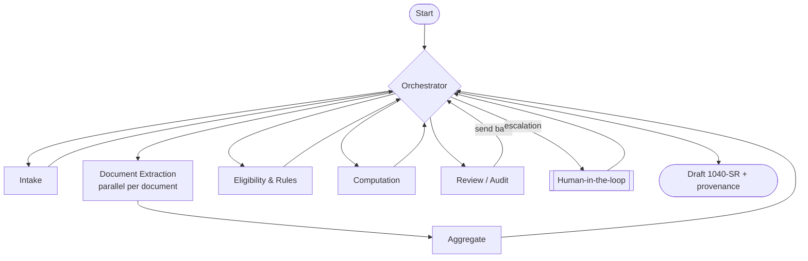

# SilverFile

A multi-agent system, built for Kushim, that helps prepare a draft **Form 1040-SR (U.S. Tax Return for Seniors), tax year 2025**.

SilverFile collects information from the taxpayer, reads their tax documents, and produces:

1. A **draft 1040-SR**, where every dollar amount shows where it came from (its provenance).
2. A **"superuser" dashboard** that Kushim employees use to track returns and resolve human-in-the-loop (HITL) escalations.

> SilverFile helps prepare a return. It is not a tax preparer or a tax advisor. It **never files anything**, **never gives tax advice**, **never shows a dollar amount it cannot source**, and **always hands off to a human** when it hits an escalation condition.

---

## Team

| Focus area | Team member assigned |
|---|---|
| Agent memory | Iris |
| Inter-agent communication | Anupama |
| Task division and management | Vidhatri |
| MLOps/DevOps | Max |
| Guardrails and ethics | Juee |
| Security | Qiyan |

Team members: Vidhatri Hegde, Qiyan Zhai, Max Charles, Iris Li, Juee Patil, Anu

---

## Agents

| Agent | Responsibility | Constraint |
|---|---|---|
| **Orchestrator** | Decides which agent acts next and when the run ends | Does not extract data, compute amounts, or talk to the user |
| **Intake** | The only agent that talks to the taxpayer: filing status, age, blindness, dependents, documents, estimated payments | Does no arithmetic and does not interpret tax rules |
| **Document Extraction** | Turns tax documents (W-2 images) into typed, structured records | Does not decide what a value means for the return |
| **Eligibility & Rules** | 1040-SR eligibility, filing-status checks, box counts, which schedules apply, scope checks | Grounded in `data/policy.md`; must cite it |
| **Computation** | Fills in every derived line | All arithmetic goes through deterministic MCP tool calls |
| **Review / Audit** | Tries to find problems in the assembled return and sends work back | Never fixes things itself |

## Orchestration

<!-- TODO: replace with the final diagram (docs/graph.png) -->



The graph must include:

- **Conditional routing**, where the orchestrator picks the next step based on the current state.
- **A parallel branch with an aggregation step**, using a state reducer that handles concurrent writes safely.
- **A review→revise cycle** with an explicit, tested limit on iterations.
- **A loop guard** that detects a pathological handoff cycle and breaks it. A test case triggers it.

## Human-in-the-loop escalation

LangGraph interrupts fire for:

1. Any out-of-scope item (itemized deductions, Schedule C/E/D, 1099-NEC, digital assets, foreign income, amended or prior-year returns, state returns)
2. An unresolved conflict between what the user says and what a document shows
3. A 1099-R with box 2b "taxable amount not determined" checked
4. A request for tax advice, planning, or optimization
5. Ambiguous filing status, such as a spouse who died during the tax year
6. Signs of financial exploitation or third-party pressure

> **Test SSNs only:** the system accepts only SSNs in the 900–999 range (e.g. `901-XX-XXXX`).

---

## Repository layout

```
.
├── README.md
├── requirements.txt
├── .env.example
├── run.py
├── src/
│   ├── state.py
│   ├── graph.py
│   ├── memory.py
│   └── agents/
├── data/
│   ├── generate_fixtures.py
│   ├── policy.md
│   └── fixtures/
├── evals/cases.json
├── tests/              # test_merge_order.py, test_decision_table.py, ...
├── traces/
├── docs/               # graph.png, metrics.md, IMPLEMENTATION_NOTES.md, AI_DISCLOSURE.md
└── demo/               # eval_case_1.md, eval_case_2.md, W-2 images, demo_video.mp4
```

---

## Getting started

> TODO: fill in as the implementation lands.

### Prerequisites

- Python 3.11+
- An LLM API key (see `.env.example`)

### Setup

```bash
git clone https://github.com/vidhu-hegde/Multi-Agent-Tax-System.git
cd Multi-Agent-Tax-System
python -m venv .venv
source .venv/bin/activate
pip install -r requirements.txt
cp .env.example .env   # then add your API keys
```

### Run

```bash
python run.py
```

### Context-window strategy measurement

```bash
python run.py --batch                        # strategy enabled
python run.py --batch --no-context-strategy  # strategy disabled
```

Results are recorded in [`docs/metrics.md`](docs/metrics.md).

### Tests

```bash
pytest tests/
```

---

## Demo / eval cases

- [`demo/eval_case_1.md`](demo/eval_case_1.md): a clean run with no escalations
- [`demo/eval_case_2.md`](demo/eval_case_2.md): triggers a HITL event, with steps to resolve it

## Documentation

- [`docs/IMPLEMENTATION_NOTES.md`](docs/IMPLEMENTATION_NOTES.md)
- [`docs/metrics.md`](docs/metrics.md)
- [`docs/AI_DISCLOSURE.md`](docs/AI_DISCLOSURE.md)
