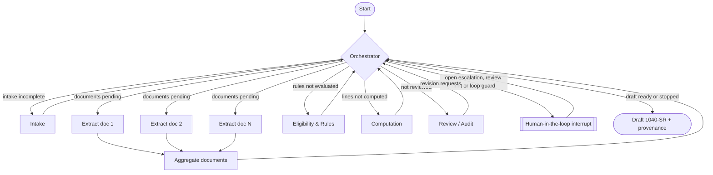

# SilverFile

A multi-agent system, built for Kushim, that helps prepare a draft **Form 1040-SR (U.S. Tax Return for Seniors), tax year 2025**.

SilverFile collects information from the taxpayer, reads their tax documents, and produces:

1. A **draft 1040-SR**, where every dollar amount shows where it came from (its provenance).
2. A **"superuser" dashboard** that Kushim employees use to track returns and resolve human-in-the-loop (HITL) escalations.

> SilverFile helps prepare a return. It is not a tax preparer or a tax advisor. It **never files anything**, **never gives tax advice**, **never shows a dollar amount it cannot source**, and **always hands off to a human** when it hits an escalation condition.

---

## Team

| Focus area | Team member assigned |
|---|---|
| Agent memory | Iris |
| Inter-agent communication | Anupama |
| Task division and management | Vidhatri |
| MLOps/DevOps | Max |
| Guardrails and ethics | Juee |
| Security | Qiyan |

Team members: Vidhatri Hegde, Qiyan Zhai, Max Charles, Iris Li, Juee Patil, Anu

---

## Agents

| Agent | Responsibility | Constraint |
|---|---|---|
| **Orchestrator** | Decides which agent acts next and when the run ends | Does not extract data, compute amounts, or talk to the user |
| **Intake** | The only agent that talks to the taxpayer: filing status, age, blindness, dependents, documents, estimated payments | Does no arithmetic and does not interpret tax rules |
| **Document Extraction** | Turns tax documents (W-2 images) into typed, structured records | Does not decide what a value means for the return |
| **Eligibility & Rules** | 1040-SR eligibility, filing-status checks, box counts, which schedules apply, scope checks | Grounded in `data/policy.md`; must cite it |
| **Computation** | Fills in every derived line | All arithmetic goes through deterministic MCP tool calls |
| **Review / Audit** | Tries to find problems in the assembled return and sends work back | Never fixes things itself |

## Orchestration

Hub-and-spoke: every agent returns to the orchestrator, which picks the next hop from state.
The full routing table and design notes are in [`docs/IMPLEMENTATION_NOTES.md`](docs/IMPLEMENTATION_NOTES.md).



- **Conditional routing:** the orchestrator applies a routing table to the current state.
- **Parallel branch:** one extraction branch per document (`Send`), joined at *Aggregate documents*; the `documents` reducer merges concurrent writes.
- **Review → revise cycle:** bounded at `SILVERFILE_MAX_REVIEW_PASSES` (default 3), then escalates.
- **Loop guard:** the same handoff (from, to, reason) repeated `SILVERFILE_LOOP_GUARD_REPEATS` times escalates to a human.

## Human-in-the-loop escalation

LangGraph interrupts fire for:

1. Any out-of-scope item (itemized deductions, Schedule C/E/D, 1099-NEC, digital assets, foreign income, amended or prior-year returns, state returns)
2. An unresolved conflict between what the user says and what a document shows
3. A 1099-R with box 2b "taxable amount not determined" checked
4. A request for tax advice, planning, or optimization
5. Ambiguous filing status, such as a spouse who died during the tax year
6. Signs of financial exploitation or third-party pressure

> **Test SSNs only:** the system accepts only SSNs in the 900–999 range (e.g. `901-XX-XXXX`).

---

## Repository layout

```
.
├── README.md
├── requirements.txt
├── .env.example
├── run.py
├── src/
│   ├── state.py
│   ├── graph.py
│   ├── memory.py
│   ├── tools.py        # call_tool(): in-process, or the tax_math MCP server
│   ├── tax_math/       # rules.py, registry.py, server.py (python -m src.tax_math.server)
│   └── agents/
├── data/
│   ├── generate_fixtures.py
│   ├── policy.md
│   └── fixtures/
├── evals/cases.json
├── tests/              # test_merge_order.py, test_decision_table.py, ...
├── traces/
├── docs/               # graph.png, metrics.md, IMPLEMENTATION_NOTES.md, AI_DISCLOSURE.md
└── demo/               # eval_case_1.md, eval_case_2.md, W-2 images, demo_video.mp4
```

---

## Getting started

> TODO: fill in as the implementation lands.

### Prerequisites

- Python 3.11+
- An LLM API key (see `.env.example`)

### Setup

```bash
git clone https://github.com/vidhu-hegde/Multi-Agent-Tax-System.git
cd Multi-Agent-Tax-System
python -m venv .venv
source .venv/bin/activate
pip install -r requirements.txt
cp .env.example .env   # then add your API keys
```

### tax_math MCP server

Every amount on the draft comes from a tax_math tool call (`call_tool()` in `src/tools.py`). `.env.example`
sets `TAX_MATH_MCP_URL=http://localhost:8001/mcp`, so the tools run on the MCP server, and it must be running
before `run.py` or the dashboard starts:

```bash
python -m src.tax_math.server              # http://127.0.0.1:8001/mcp (TAX_MATH_MCP_HOST; 0.0.0.0 in Docker)
python -m src.tax_math.server --port 8002  # another port: change TAX_MATH_MCP_URL to match
```

`run.py` and the dashboard read `TAX_MATH_MCP_URL` from `.env` and check the server at startup; if it is not
answering they stop with a message instead of failing partway through a return. Comment the line out of `.env`
to run the same tools in-process, with no server. There is never a silent fallback from one to the other. Tests
always run in-process, except `tests/test_tax_math_mcp.py`, which starts its own server on a free local port.

### Run

```bash
python run.py                                            # interactive session
python run.py --case data/fixtures/skeleton_case.json    # run a case file
python run.py --thread-id <session id>                   # resume a saved session
```

### Staff dashboard

```bash
python -m src.dashboard           # http://127.0.0.1:8000, the same sessions as run.py
python -m src.dashboard --demo    # a separate demo database with returns in every state
```

The dashboard shows the queue of escalations waiting on staff and every return's status. For each
escalation it shows the evidence, and for an unreadable W-2 it also shows the uploaded image. Staff
continue (with a note, a chosen record, or the values typed from the document) or stop the session,
and can open each draft with the source of every amount. `--demo` seeds `output/demo.sqlite` from the
eval cases, offline, and never touches the real database.

### Staff commands

The same actions the dashboard offers, from the terminal:

```bash
python run.py --sessions                                   # list sessions and open escalations
python run.py --resolve <session id> <ticket id> --note "Checked with client"
python run.py --resolve <session id> <ticket id> --stop    # end the session instead
python run.py --resolve <session id> <ticket id> --values '{"employer_name": "...", "wages": "..."}'  # a document that couldn't be read
```

### Context-window strategy measurement

```bash
python run.py --batch                        # strategy enabled
python run.py --batch --no-context-strategy  # strategy disabled
```

Results are recorded in [`docs/metrics.md`](docs/metrics.md).

### Tests

```bash
pytest tests/
```

---

## Getting started with Docker

One image runs everything (`Dockerfile`); `docker-compose.yml` starts the tax_math MCP server (`tax-math`) and
the staff dashboard, and runs `run.py`, the evals and the tests on demand (`app`). You need Docker Desktop (or
another Docker engine) with Compose 2.24 or newer.

```bash
git clone https://github.com/vidhu-hegde/Multi-Agent-Tax-System.git
cd Multi-Agent-Tax-System
cp .env.example .env            # optional: add ANTHROPIC_API_KEY to use run.py; everything else works without it
docker compose up -d --build    # tax-math (healthy) + dashboard at http://127.0.0.1:8000
```

| Task | Command |
|---|---|
| Staff dashboard | http://127.0.0.1:8000 (published on this machine only) |
| Evals (through tax-math) | `docker compose run --rm app python -m evals.run_evals` |
| Evals, tax math in-process | `docker compose run --rm -e TAX_MATH_MCP_URL= app python -m evals.run_evals` |
| Tests | `docker compose run --rm app python -m pytest -q -p no:cacheprovider` |
| Taxpayer session (needs the key) | `docker compose run --rm app python run.py --case data/fixtures/skeleton_case.json` |
| Resume a session | `docker compose run --rm app python run.py --thread-id <session id>` |
| List sessions | `docker compose run --rm app python run.py --sessions` |
| Logs | `docker compose logs -f dashboard tax-math` |
| Stop (keeps sessions) | `docker compose down` |
| Stop and delete all sessions | `docker compose down -v` |

**Demo dashboard.** The demo uses the same port, so stop the normal dashboard first:

```bash
docker compose stop dashboard
docker compose run --rm --service-ports dashboard python -m src.dashboard --demo --host 0.0.0.0
# Ctrl-C to stop it, then: docker compose start dashboard
```

**What persists.** Sessions live in `/app/state/silverfile.sqlite` on the `state` volume, which `app` and the
dashboard share. The demo database, its case files and HTML drafts (`run.py --html output/draft.html`) live
in `/app/output` on the `output` volume. Both survive `docker compose down` and are deleted only by
`down -v`. `data/` (policy.md, fixtures) comes from the image and is never a volume.

**Restart check, no key needed:**

1. Start the demo dashboard (above). It prints `Demo database: /app/output/demo.sqlite (8 new returns)`.
2. Open http://127.0.0.1:8000, open *demo-wage-conflict*, enter a staff ID and choose Continue.
3. Ctrl-C, then `docker compose down` (no `-v`) and `docker compose up -d`.
4. Start the demo again: it prints `(0 new returns)`, and *demo-wage-conflict* shows your decision under
   "Decisions so far".

With a key, the same works for a taxpayer session: start one with `run.py --case ...`, note the session id,
press Ctrl-D (the session is saved), `down`, `up -d`, then `run.py --thread-id <session id>`.

**Notes.**

- `.env` is read at run time (`env_file`) and never copied into the image (`.dockerignore`). Compose sets
  `TAX_MATH_MCP_URL=http://tax-math:8001/mcp` and the database path itself, overriding the `localhost` and
  `data/` values in `.env`, which are for running outside Docker.
- Port 8001 is not published: only the containers reach tax-math.
- `constraints.txt` pins the image to the exact versions we tested (`pip install -r requirements.txt -c
  constraints.txt`). After changing `requirements.txt`, regenerate it inside the container, not on your Mac
  (some packages differ by platform): `docker compose build`, then
  `docker compose run --rm --no-deps -T app pip freeze > constraints.txt` (`-T`: without it the TTY adds `\r` to every line).
- The code in the image is read-only to the app (it runs as user `silverfile`, uid 1000); only `/app/state`
  and `/app/output` are writable. To run your own case file, mount it read-only, for example
  `docker compose run --rm -v "$PWD/cases:/app/cases:ro" app python run.py --case cases/mine.json`, and mount it
  again at the same path to resume.
- If run.py or the dashboard says the tax_math server is unreachable, check `docker compose ps`: tax-math
  should be `healthy`. A `421 Invalid Host header` means it is listening on 127.0.0.1 instead of 0.0.0.0.
- Port 8000 already in use (a local dashboard, say): stop that, or change `127.0.0.1:8000:8000` to
  `127.0.0.1:8080:8000` and open http://127.0.0.1:8080.

---

## Demo / eval cases

End-to-end eval cases live in [`evals/cases.json`](evals/cases.json) (format: [`evals/README.md`](evals/README.md)).
They run offline and are part of `pytest`:

```bash
python -m evals.run_evals
```

- [`demo/eval_case_1.md`](demo/eval_case_1.md): a clean run with no escalations
- [`demo/eval_case_2.md`](demo/eval_case_2.md): triggers a HITL event, with steps to resolve it

## Documentation

- [`docs/IMPLEMENTATION_NOTES.md`](docs/IMPLEMENTATION_NOTES.md)
- [`docs/metrics.md`](docs/metrics.md)
- [Team report draft with Mermaid diagrams](docs/TEAM_REPORT_DRAFT.md)
- [`docs/AI_DISCLOSURE.md`](docs/AI_DISCLOSURE.md)


## Extraction and provenance draft view

The communication/extraction integration is documented in [Anupama's handoff](docs/ANUPAMA_HANDOFF.md).
Render the existing synthetic typed case without a model key:

```powershell
.\.venv\Scripts\python -m src.render --case data/fixtures/skeleton_case.json --output output/draft_1040sr.html
```

Open the HTML file and click or keyboard-activate an amount to inspect its sources and calculation.
Stub-dependent or stale amounts are withheld. For live W-2 vision, configure local `.env` credentials
and use `demo/anupama_vision_case.json`; live accuracy testing is pending. See the handoff for
manual-entry metadata, agent contracts, revisions, test commands and integration dependencies.
[Anupama's report section](docs/ANUPAMA_REPORT.md) and [AI-use disclosure](docs/AI_DISCLOSURE.md)
record the scope and limits of this contribution.
