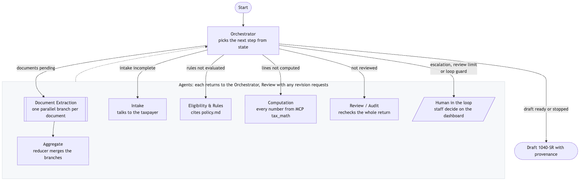

# SilverFile

A multi-agent system, built for Kushim, that helps prepare a draft **Form 1040-SR (U.S. Tax Return for Seniors),
tax year 2025**. It talks with the taxpayer, reads their tax documents, and produces:

1. A **draft 1040-SR** where every dollar amount shows where it came from.
2. A **staff dashboard** where Kushim employees track returns and resolve human-in-the-loop (HITL) escalations.

> SilverFile **never files anything**, **never gives tax advice**, **never shows an amount it can't source**, and
> **hands off to a person** whenever it hits an escalation condition. It accepts only test SSNs (900–999).

## Running SilverFile with Docker (for graders)

Everything below runs in Docker; no Python setup is needed. You need Docker Desktop (Compose 2.24 or newer) and an
Anthropic API key for steps 2 to 4. Run every command from the repository folder.

### 1. Set up (once)

```bash
git clone https://github.com/vidhu-hegde/Multi-Agent-Tax-System.git
cd Multi-Agent-Tax-System
cp .env.example .env              # then open .env and set ANTHROPIC_API_KEY=<your key>
docker compose up -d --build      # builds the image, starts the tax-math server and the dashboard
```

Open the staff dashboard at http://127.0.0.1:8000. It stays running in the background until step 7.

### 2. Eval case 1: a clean run, with the W-2 read from its photo

```bash
docker compose run --rm app python run.py --case demo/anupama_vision_case.json
```

The session runs to the end without asking anything and prints `Draft 1040-SR (draft_ready)` with line 34
(overpayment) at **2,455.50**. On the dashboard the return shows as *Draft ready*: open it, then *Open the draft with
sources*, and click any amount to see where it came from. Expected values and a hand check of every line:
[`demo/eval_case_1.md`](demo/eval_case_1.md).

### 3. Eval case 2: a HITL event, resolved on the dashboard

```bash
docker compose run --rm app python run.py --case data/fixtures/conflict_case.json
```

The taxpayer said about $24,000 in wages but the W-2 shows $26,450, so the session stops with
`[Escalation: document_conflict]`. Press **Ctrl-D** to save and leave: the decision belongs to staff. Then, on the
dashboard:

1. Under **Needs a decision**, open the return. The ticket shows both amounts.
2. Type a note (for example *Harold confirmed the W-2 is right*) and a staff ID (for example `staff-7`).
3. Choose **Continue the return**. The return becomes *Draft ready*, with a refund of **$1,460.25**.
4. Choose **Mark as submitted**. The return now appears under the *Submitted* filter.

Full walkthrough: [`demo/eval_case_2.md`](demo/eval_case_2.md).

### 4. A clean run with your own data

Copy a case file into a `cases` folder, edit its answers and document values, and run it with that folder mounted:

```bash
mkdir -p cases
cp data/fixtures/skeleton_case.json cases/mine.json      # then edit cases/mine.json
docker compose run --rm -v "$PWD/cases:/app/cases:ro" app python run.py --case cases/mine.json
```

Leave an answer out of the file and Intake asks for it. To answer every question yourself instead, run
`docker compose run --rm app python run.py`. A document you only name in the chat (by typing "W-2") has no values,
so it pauses for staff to type them in on the dashboard.

### 5. The dashboard with returns in every state (no key needed)

```bash
docker compose stop dashboard
docker compose run --rm --service-ports dashboard python -m src.dashboard --demo --host 0.0.0.0
```

Open http://127.0.0.1:8000: it shows demo returns waiting on staff, waiting on the taxpayer, ready and submitted.
Press Ctrl-C to stop it, then `docker compose start dashboard` to bring back the normal dashboard.

### 6. Tests and eval cases (no key needed)

```bash
docker compose run --rm app python -m pytest -q -p no:cacheprovider    # all tests
docker compose run --rm app python -m evals.run_evals                  # all eval cases, through the tax-math server
```

### 7. Stop

```bash
docker compose down        # stops everything; saved returns are kept
docker compose down -v     # stops everything and deletes saved returns
```

Other commands (resuming a return, listing returns, logs) and troubleshooting are in [`docs/DOCKER.md`](docs/DOCKER.md).
Finished runs of both eval cases, viewable without running anything, are in [`traces/`](traces/README.md).

## How it works

Six agents plus a human-in-the-loop step. Every agent returns to the orchestrator, which picks the next step from
the current state.

| Agent | Job | Never |
|---|---|---|
| **Orchestrator** | Decides which agent acts next, and when the return is done | Extracts, computes, or talks to the taxpayer |
| **Intake** | The only agent that talks to the taxpayer, one question at a time | Does arithmetic or interprets tax rules |
| **Document Extraction** | Turns tax documents, including W-2 photos, into typed records | Decides what a value means for the return |
| **Eligibility & Rules** | Eligibility, filing status, deduction boxes, scope; cites [`data/policy.md`](data/policy.md) | Decides anything without citing the policy |
| **Computation** | Fills in every calculated line | Does arithmetic itself: every number is an MCP tool call |
| **Review / Audit** | Rechecks the whole return and sends problems back | Fixes anything itself |



Source: [`docs/graph.mmd`](docs/graph.mmd).

- **Conditional routing:** the next step depends on the state, not a fixed order.
- **Parallel branch:** documents are read in parallel and merged by a reducer.
- **Bounded review loop:** Review can send work back up to 3 times (`SILVERFILE_MAX_REVIEW_PASSES`), then a person
  decides.
- **Loop guard:** the same handoff repeated 3 times (`SILVERFILE_LOOP_GUARD_REPEATS`) stops for a person.

**A person is asked** when there is an out-of-scope item, a conflict between the taxpayer and a document, a 1099-R
with box 2b checked, a request for tax advice, an unclear filing status, or any sign of financial exploitation. It
also happens when a document can't be read or the taxpayer isn't sure of an answer. Every reason is listed in
[`data/policy.md`](data/policy.md#escalation).

**In scope:** W-2, SSA-1099, 1099-R, 1099-INT and 1099-DIV; all five filing statuses; the standard deduction and the
senior deduction; Schedule 1, 2 and 3 totals typed in directly. Everything else goes to a person.

## Running without Docker

Needs Python 3.11 or newer and two terminals. Install, then start the tax-math server and the dashboard:

```bash
python -m venv .venv && source .venv/bin/activate
pip install -r requirements.txt -c constraints.txt
cp .env.example .env                  # then set ANTHROPIC_API_KEY in .env

python -m src.tax_math.server         # terminal 1: the tax-math server; leave it running
python -m src.dashboard               # terminal 2: the dashboard at http://127.0.0.1:8000
```

Then, in another terminal:

```bash
python run.py --case data/fixtures/skeleton_case.json     # a return from a case file
python run.py --case demo/anupama_vision_case.json        # the same return, W-2 read from its photo
python run.py                                             # answer every question yourself
python run.py --thread-id <session id>                    # resume a saved return (Ctrl-D saves and leaves)
python run.py --sessions                                  # list returns and open escalations
python run.py --resolve <session id> <ticket id> --staff-id staff-7   # resolve from the terminal (--stop to stop)
python run.py --submit <session id> --staff-id staff-7    # mark a finished return as submitted
python -m src.render --case data/fixtures/skeleton_case.json --output output/draft.html   # draft, no key

python -m pytest -q                                       # tests
TAX_MATH_MCP_URL= python -m evals.run_evals               # eval cases, offline, no server needed
python run.py --batch [--no-context-strategy]             # context-window measurement (needs the key)
```

## Documentation

- [`docs/IMPLEMENTATION_NOTES.md`](docs/IMPLEMENTATION_NOTES.md): design decisions and the full routing table
- [`docs/metrics.md`](docs/metrics.md): context-window measurement
- [`data/policy.md`](data/policy.md): the tax rules, scope and escalation reasons
- [`docs/GUARDRAILS_AND_ETHICS.md`](docs/GUARDRAILS_AND_ETHICS.md), [`docs/SECURITY_AND_PII.md`](docs/SECURITY_AND_PII.md):
  guardrails and security
- [`docs/DOCKER.md`](docs/DOCKER.md): Docker in detail
- [`evals/README.md`](evals/README.md): how the eval cases work

## Team

| Focus area | Team member |
|---|---|
| Agent memory | Iris Li |
| Inter-agent communication | Lakshmi Anupama Tamarapalli |
| Task division and management | Vidhatri Hegde |
| MLOps/DevOps | Max Charles |
| Guardrails and ethics | Juee Patil |
| Security | Qiyan Zhai |
