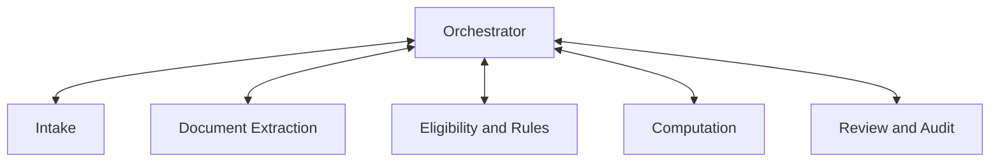
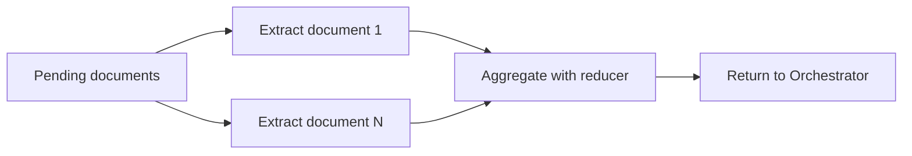
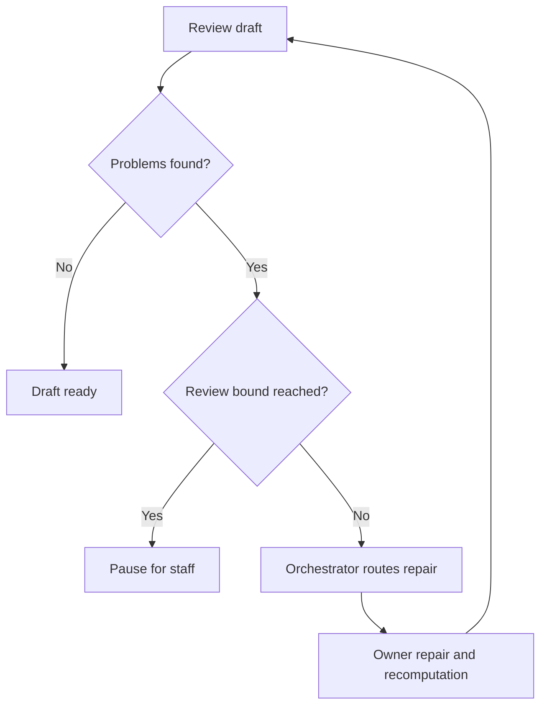

# SilverFile: system design and evaluation

Review draft | 28 October 2026 | PR #15 with main at `1bfd9e8`

Draft for team review. Final pagination is pending.

## 1. Purpose and architecture

SilverFile prepares a draft of the supported 2025 Form 1040-SR lines for Kushim staff to review. It collects taxpayer answers, reads tax documents, applies the assignment's rules and links each displayed amount to its evidence. The staff dashboard lists returns and lets employees resolve human-in-the-loop (HITL) tickets. SilverFile does not file returns or give tax advice. Unsupported work and unresolved concerns pause for staff.

The system uses LangGraph with a hub-and-spoke topology. The Orchestrator chooses the next agent from typed state: unfinished Intake, pending documents, missing rule decisions, uncomputed lines or pending Review. Agents return to that hub. Keeping routing separate from transcription and arithmetic gives each agent a testable boundary and makes responsibility visible in the audit record.

Each agent exchanges work with the Orchestrator through typed state. These links represent conditional routing and returns to the hub, not a fixed execution sequence.

Extraction creates one task per pending document. An aggregation step joins those outputs using a reducer that preserves disjoint records and exposes conflicts for staff. Review returns revision requests to the hub, which sends them to the responsible agent and requires another review. Three unsuccessful review passes trigger a human ticket by default. A separate guard detects repeated identical handoffs without progress, so a pathological cycle also stops.

SQLite checkpoints retain a return between processes. The CLI and dashboard use the same session interface and database. A named Docker volume keeps that database across container recreation. The output is a reviewable HTML draft covering supported lines, with sources accessible by keyboard or mouse. The system's supported subset and remaining output gaps are stated in section 5.

Design evidence: [README](../README.md), [implementation notes](IMPLEMENTATION_NOTES.md), [graph](../src/graph.py), [Orchestrator](../src/agents/orchestrator.py), [graph tests](../tests/test_graph.py) and [merge-order tests](../tests/test_merge_order.py). The three diagrams separate the agent topology, parallel extraction and bounded revision loop.

## 2. The six agents and their contracts

### Orchestrator

The Orchestrator owns routing and termination. It reads state rather than following a fixed sequence. Open tickets, review limits and repeated handoffs interrupt the workflow. It neither talks to the taxpayer nor extracts or computes values. The shared revision contract lets it route an Intake correction, document re-extraction or Rules repair before another Computation and Review pass.

### Intake

Intake is the only agent that converses with the taxpayer. It collects filing status, relevant birth dates and blindness inputs, dependents, document inventory and direct totals. Each prompt requests one field. It validates answers through shared contracts, records confirmation history and supports repetition, go-back and corrections. It raises volunteer or scope tickets without doing arithmetic or interpreting tax rules. Partial case-file imports are checkpointed before the next question.

### Document Extraction

Extraction validates W-2 observations from Claude vision against a typed W2Record. It keeps the source image path/hash and model-response identity. Other supported forms can use typed direct entries with author and time. Missing, unreadable or incomplete observations require staff input or a stop; the system must not silently omit a document. Extraction transcribes fields but leaves their meaning to Rules.

### Eligibility and Rules

Rules applies the supplied policy corpus to eligibility, filing status, age/blindness boxes, schedules and scope. Decisions include citations. Intake supplies dates and facts; Rules determines the applicable boxes and counts. Standard-deduction exceptions and unsupported documents escalate. This separation keeps policy decisions out of the conversational and extraction agents.

### Computation

Computation populates derived lines in dependency order through deterministic tax_math tools. Taxable Social Security needs the other income and adjustments before it can feed total income and AGI. The same dependency discipline applies to deductions, tax, Schedule totals and payments. The MCP transport records the server route in provenance and fails explicitly on outage. Tool results are rounded to cents once at the common boundary.

### Review and Audit

Review independently reconstructs source amounts and core tax-rule inputs, checks provenance and dependencies, and returns typed repair requests. It never edits the draft itself. It checks more than arithmetic consistency: a plausible source label or coherently wrong tax total must not pass. Persistent defects reach the tested review bound. Agent-boundary validation also rejects malformed records and writes outside the responsible role.

Contract evidence: [schemas](../src/schemas.py), [communication](../src/communication.py), [evidence](../src/evidence.py) and [agents](../src/agents/). [Review](../tests/test_review.py), [graph](../tests/test_graph.py) and [MCP tests](../tests/test_tax_math_mcp.py) cover those boundaries.

## 3. Memory and accessible Intake

A return uses an opaque thread ID that cannot be an SSN. The shared SQLite saver serializes typed contracts so the CLI, staff dashboard and later processes can read the same work. Accepted answers are saved before another question. A partial imported case also saves its validated fields before interrupting, preventing an empty recap after restart.

Answer history records confirmations rather than overwriting the prior value. Current values follow confirmation time; a delayed retry cannot restore an old answer over a newer correction. Duplicate effective answers do not create another change. Conflicting same-time confirmations fail explicitly. Answer history assumes one Intake writer. Document branches use a separate reducer: independent writes survive either order, while conflicting records remain available for staff selection.

Changing an input archives earlier evidence, clears stale lines and requests fresh Rules/Computation work. Review then checks the replacement draft. This keeps a corrected value from appearing beside an old refund. The five-process SQLite regression checks retained imports, recalculated amounts, new payment provenance, archived prior lines and isolation from a second return.

| Design choice | Observable behavior |
|---|---|
| One question at a time | Dependent name, relationship and required test SSN have separate prompts. |
| Plain language | Filing statuses use full names; Schedule/payment prompts include brief explanations. |
| Repetition and drift | Unrelated replies return to the pending question; go-back preserves other answers. |
| Resumability | Reopening the same thread gives one short recap and continues at the unanswered question. |
| Honest uncertainty | An unsure reply creates a volunteer ticket; staff resolution returns to the same question. |
| Minimize PII | No taxpayer SSN is requested. Dependent SSNs use only the assignment's synthetic range; recaps omit DOB values and SSNs. |

These choices reduce the amount a taxpayer must remember and allow staff assistance without restarting a return. The CLI driver validates or redacts replies before constructing resume commands, because LangGraph can persist a command before Intake runs. Model summaries exclude typed dependent, DOB and document records. Required test dependent identifiers remain in their typed records.

The recorded team demo must show at least four choices through actions. The prepared Iris sequence covers restart/recap, correction, drift and volunteer recovery. Keyboard tests verify source disclosure and a narrow viewport; they are not a screen-reader audit. Final wording and a human accessibility review remain team work.

Memory/accessibility evidence: [Iris report](IRIS_REPORT.md), [demo sequence](../demo/iris_memory_accessibility.md), [memory](../tests/test_memory.py), [Intake](../tests/test_intake.py), [dialogue](../tests/test_dialogue_dignity.py) and [integration tests](../tests/test_iris_integration.py).

## 4. Verification, provenance and failure handling

The current integrated revision passes 674 pytest tests with seven existing PyMuPDF/SWIG warnings. All 25 shared offline cases pass in-process and through a real local tax_math MCP server. The pinned Docker image also builds and passes 674 tests and all 25 MCP evals. A current isolated container-recreation check preserves partial imports, one recap and a dashboard staff decision without a model key. These results cover the committed synthetic fixtures and injected faults. The live W-2 and earlier Docker evidence in this report were reported by teammates on their tested revisions; they are distinct from this offline follow-up.

| Check | Evidence and limit |
|---|---|
| Clean return | The typed fixture reaches draft_ready with a $2,455.50 refund. The image-based walkthrough requires a key. |
| HITL recovery | The wage-conflict fixture pauses, records a staff decision and completes with a $1,460.25 refund. |
| Correction and restart | Five real Python processes preserve history, pending question, current/archived provenance and thread isolation. |
| Schedule 2/3 | Nonzero direct totals reach lines 20, 23 and 31; totals and refunds match literal expectations. Zeroed-input fault controls fail evaluation. |
| Review and routing faults | Seeded source/tax/provenance defects return repair requests; persistent failures and pathological cycles trigger tested bounds. |
| W-2 vision | The repository records 2/2 images and 16/16 fields each; #19 reports the numeric comparison fix and a repeated live check. |

Each monetary line carries provenance. Document sources retain form/field identity and captured evidence; direct inputs retain who entered them and when. Derived lines retain tool inputs/results and dependency links. The HTML view exposes that chain and withholds stale, missing-evidence or stub-dependent amounts. Review independently checks the chain rather than trusting its labels.

Staff see every return's status and open tickets in the dashboard. They can inspect evidence, enter unreadable W-2 fields, resolve supported tickets or stop. A tax_math outage is shown as an operational failure with a resume action, outside the taxpayer ticket queue. The two graded walkthroughs in demo/ document the clean and resolved-HITL paths.

Selective recall sends the current classifier item and a small approved summary. OFF also sends earlier classifier dialogue. Both record actual provider input usage by call ID. Invalid model output and absent usage fail benchmark validation. Live token measurements remain a teammate task: integrate [PR #21](https://github.com/vidhu-hegde/Multi-Agent-Tax-System/pull/21) and the agreed multi-turn items, then retain ten per-item ON/OFF rows, outcomes, raw JSON and a curve in docs/metrics.md. No synthetic token values are reported as results.

The 42-item guardrail development set passes after tuning; it cannot estimate accuracy on unseen wording. Security tests cover recognized SSN patterns and shared ingress, not encrypted storage or production authentication. Further privacy controls would be needed for real taxpayer use.

## 5. Contributions, limitations and submission status

| Contributor and specialization | Implemented responsibility |
|---|---|
| Iris Li: Agent memory | Intake continuity, answer history/reducers, SQLite identity/restart, corrections, selective-context harness and focused evaluation. |
| Anupama: Inter-agent communication | Shared contract integration, extraction/vision, revision/evidence interfaces and the accessible provenance draft view. |
| Vidhatri Hegde: Task division and management | Graph/routing, loop bounds, staff/session hooks, dashboard, integration, Schedule totals and graded walkthroughs. |
| Max Charles: MLOps/DevOps | Deterministic computation tools, MCP transport, rounding, Docker persistence and dependency pins; batch wiring and a metrics-table generator are proposed in PR #21. |
| Juee Patil: Guardrails and ethics | Policy corpus, cited Rules decisions, escalation vocabulary, language rules and guardrail evaluation. |
| Qiyan Zhai: Security | Resume/staff validation, PII handling, secure boundaries, independent Review/Audit and recovery tests. |

The contribution table follows README assignments, source records and merged PRs. Team members should confirm wording before submission. Integration commits and report editing do not transfer implementation credit between contributors.

Dependent details can be collected, but dependent output and credits remain incomplete; those workflows pause. Line 17 is unsupported. QCD, line 25c/other direct-input coverage and the limited adjustment set need the appropriate schema, policy and computation owners. A staff continue action cannot supply missing software. Unsupported cases should stop until their integration is complete.

The system escalates itemized deductions, business/rental income, Schedule D gains, digital assets, foreign items, amended/prior-year or state returns, and uncertain 1099-R taxable amounts under the assignment's scope. It also stops for advice requests, unresolved document conflicts, ambiguous filing status and exploitation concerns. Staff must use the reason-specific resolution contract. Language rules have finite coverage and can over-flag ordinary help.

The dashboard HITL implementation and Docker packaging are merged. [PR #20](https://github.com/vidhu-hegde/Multi-Agent-Tax-System/pull/20) adds the remaining dashboard Submitted status and is still open; the full dashboard bonus should be assessed after that integration. Docker uses pinned packages, a non-root app user and persistent named volumes. Vidhatri's #17 review records a keyed partial-return restart across compose down/up and a completed image-based draft. Final submission should preserve the exact revision and deployment evidence used for recording.

This report remains a review draft. Iris must confirm her own disclosure and perform her prepared demo segment. Existing disclosure text is available for Anupama, Iris, Juee and Qiyan; Max and Vidhatri still need to supply theirs in the repository. The team must approve the report, finish live context measurements and publish a 5-to-10-minute video showing the integrated clean/HITL paths and at least four accessibility choices.

Source record: [Security/Review #11](https://github.com/vidhu-hegde/Multi-Agent-Tax-System/pull/11), [Iris follow-up #15](https://github.com/vidhu-hegde/Multi-Agent-Tax-System/pull/15), [MCP #16](https://github.com/vidhu-hegde/Multi-Agent-Tax-System/pull/16), [Docker #17](https://github.com/vidhu-hegde/Multi-Agent-Tax-System/pull/17), [pins #18](https://github.com/vidhu-hegde/Multi-Agent-Tax-System/pull/18), [integration #19](https://github.com/vidhu-hegde/Multi-Agent-Tax-System/pull/19), [disclosures](AI_DISCLOSURE.md), [guardrails](GUARDRAILS_AND_ETHICS.md) and [security report](SECURITY_AND_PII.md). This report was drafted and edited with OpenAI Codex and Humanizer from those project records; it does not certify each contributor's approval.
