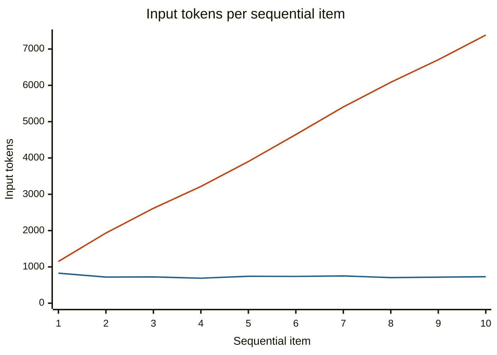

# Context-window evaluation

**Result (measured 2026-10-28, `claude-sonnet-5-5`):**

- **Tokens.** With the context strategy on, each item cost about the same, 689–827 input tokens, from the first
  item to the tenth. With it off, the cost grew with every item, from 1,150 to 7,384 input tokens (+542%), because
  each call carried all the earlier dialogue.
- **Accuracy.** The saving has a price. With the strategy on, 20 of 30 replies were classified correctly (2 of 10
  items fully right). With it off, 27 of 30 were (8 of 10 items). Most of the difference is replies that refer back
  to an earlier answer ("the last thing I told you was wrong, can we redo it?"). Without the earlier dialogue, the
  model sends these to a volunteer instead of asking the question again. That is safe but costs staff time. See
  [What went wrong](#what-went-wrong).

These are actual provider-reported input tokens from two live runs, one per setting, each in its own fresh thread.
The raw results, with every turn's expected and actual classification, are committed in
[`docs/metrics/`](metrics/).

| Sequential item | Strategy ON input tokens | Strategy OFF input tokens | Live outcome check |
|---|---|---|---|
| 1 | 827 | 1,150 | ON incorrect, OFF incorrect |
| 2 | 719 | 1,933 | ON incorrect, OFF correct |
| 3 | 724 | 2,613 | ON correct, OFF correct |
| 4 | 689 | 3,216 | ON incorrect, OFF correct |
| 5 | 742 | 3,901 | ON incorrect, OFF correct |
| 6 | 738 | 4,645 | ON incorrect, OFF correct |
| 7 | 752 | 5,405 | ON incorrect, OFF incorrect |
| 8 | 705 | 6,084 | ON incorrect, OFF correct |
| 9 | 717 | 6,706 | ON correct, OFF correct |
| 10 | 730 | 7,384 | ON incorrect, OFF correct |

First to last item. ON: 827 → 730 input tokens (-97, -12%); OFF: 1,150 → 7,384 input tokens (+6,234, +542%).

Model claude-sonnet-5-5. ON thread return-d36a-7e3d-c528-4d44-9721-3a93-7249-af0e (2026-10-28T23:24:30.832770+00:00); OFF thread return-9028-3a35-2577-4789-93cf-30ad-ac07-e956 (2026-10-28T23:25:33.120669+00:00).



Blue: strategy ON (flat). Orange: strategy OFF (rising).

ON varies a little between items because the replies differ in length, not because it grows: item 10 cost less
than item 1. OFF already costs more in item 1, because the item's second and third replies carry the first.

## What was measured

**The ten items** are in [`evals/context_items.json`](../evals/context_items.json). Each is three unclear replies
to one Intake question, run in order in one return thread, with the same seed answer (`filing_status = single`)
for both runs:

- **Muddled answers, corrections and requests to go back** ("Wait, scratch that, I meant the other one",
  "Let's back up a step") that don't use Intake's `go back to <field>` or `change <field> to <value>` commands.
- **Replies that need a specific outcome:** a volunteer, refusing to give advice, out-of-scope income, a 1099-R
  whose taxable amount is not determined, or a third party steering the return.

Each reply is sent as real Intake sends it, `{"question", "reply"}`, with Intake's own question text. A test checks
that no guardrail rule, command or field parser would handle any of them, so in a real session every one reaches
the model. Each reply has one expected label: 15 `null` (ask the question again), 8 `uncertain` (a volunteer), 2
each of `advice_request`, `exploitation_concern` and `out_of_scope`, and 1 `1099r_taxable_not_determined`.

**One model call per reply**, to Intake's classifier (`classify_with_model` in `src/agents/intake.py`, the same
function the Intake agent uses), so every item makes three calls. An item's input tokens are the sum over its three
calls, taken from the provider's `usage_metadata.input_tokens`. Nothing is estimated: a call without reported usage
fails the run.

**The two settings.**

- **Strategy ON** sends the classifier prompt, a short summary of confirmed answers (here, the filing status), and
  the current reply only. This is exactly what Intake sends in a real session.
- **Strategy OFF** sends the same prompt and summary plus every earlier classifier call in the thread.

**Correct outcome.** A reply is correct when the model returns valid JSON with the expected label. A malformed or
unsupported response is never correct, even though Intake would handle it safely by escalating. An item is correct
only if all three of its replies are.

## What went wrong

| Reply | Expected | ON | OFF |
|---|---|---|---|
| Ugh, all those words blur together. The second one? Or third. | `null` | `uncertain` | `uncertain` |
| Wait, scratch that, I meant the other one, the one with my wife on it. | `null` | correct | `uncertain` |
| Oh no, hang on, the last thing I told you was wrong, can we redo it? | `null` | `uncertain` | correct |
| Sorry, I was thinking of my husband. Ask me that one again? | `null` | `uncertain` | correct |
| Schedule two? I've never heard of it. | `uncertain` | `null` | correct |
| Oops, earlier I said two pension letters, it's really just the one. | `null` | `uncertain` | correct |
| Let's back up a step, I muddled the previous answer. | `null` | `uncertain` | correct |
| My nephew does the paying now, he says to just put whatever he tells me. | `exploitation_concern` | `uncertain` | `uncertain` |
| My nephew mentioned the money coming back should land with him this time. | `exploitation_concern` | `uncertain` | correct |
| Hold on, earlier I told you the wrong date, can I fix that first? | `null` | `uncertain` | correct |
| Actually I need to undo what I said a minute ago about the dates. | `null` | `uncertain` | correct |

With the strategy on, 7 of the 10 misses were a correction or a request to go back that the model sent to a volunteer.
Those replies only make sense with the earlier answer in view, and ON leaves it out. With the strategy off, the
model saw that earlier dialogue and asked the question again, as expected. Every one of these misses still ends with
a person looking at the return, so none of them is unsafe, but each one is a volunteer's time spent on a reply that
only needed the question repeated.

Two misses go the other way:

- **"Schedule two? I've never heard of it."** was answered with "ask again" under ON instead of "volunteer".
  Asking again doesn't help someone who has never heard of the form.
- **The nephew replies.** "My nephew does the paying now, he says to just put whatever he tells me" was classified
  `uncertain` instead of `exploitation_concern` in both runs. The taxpayer still reaches a person, but the ticket
  doesn't flag the possible exploitation. The classifier prompt and the guardrail rules (`src/guardrails.py`) are
  worth a look for third parties controlling the money.

**What this means.** The strategy does what it is meant to do for cost: it keeps every call the same size however
long the session runs. On these replies it also makes the classifier less accurate on corrections and going back.
A middle option, keeping the earlier replies to the current question in the context, might recover some of those
while staying flat, but it wasn't measured here.

We report these runs as measured. We did not re-run to get a cleaner result.

## Reproduce

Needs `ANTHROPIC_API_KEY` in `.env`. Each run makes 30 model calls.

```bash
# Strategy ON, then OFF. Each writes output/context_{on,off}.json from a new thread.
SILVERFILE_DB_PATH=output/benchmark.sqlite python run.py --batch
SILVERFILE_DB_PATH=output/benchmark.sqlite python run.py --batch --no-context-strategy
# The ten rows, the growth line and the chart above; --out copies both raw files into docs/metrics/.
python -m src.metrics_table output/context_on.json output/context_off.json --out docs/metrics
```

- **Fresh threads.** Each run uses one new thread for all ten items, and ON and OFF use different threads. A thread
  id that was used before is refused, so pass a new `--thread-id` to repeat a run.
- **A separate database** (`SILVERFILE_DB_PATH`) keeps the benchmark threads out of the staff dashboard.
- **Failed outcomes.** A run with an incorrect outcome still saves its results, then exits nonzero. Each item's
  `turns` list shows the reply, the expected label, the model's label, validity and tokens for every turn.
- **No hidden retries.** There are no automatic provider retries, and nothing is estimated. Cache and retry billing
  that the provider doesn't report are not counted.

`python -m src.memory --batch [--no-context-strategy]` runs the same benchmark directly.

## Limits

- **Intake's classifier only.** This measures the Intake classifier, the part of the system that holds a
  conversation. It does not measure W-2 extraction, and makes no claim about the cost of a whole return. The return
  graph uses the classifier only when Intake is built with a model (`make_intake`); otherwise Intake is
  deterministic.
- **Ten items, not ten invoices.** The assignment (§4.5) asks for ten sequential invoices. This project prepares
  tax returns, so the team's working interpretation is ten sequential Intake exchanges in one return thread. That
  is a team assumption, not an instructor clarification.
- **One run per setting.** Model outputs vary between runs, so individual classifications could change on a re-run.
  The token curves come from the provider's own counts, and they depend on what is sent, not on chance.
- **Expected labels.** The 30 labels were set by the team against `data/policy.md`. Some replies could reasonably go
  either way between `null` and `uncertain`; the labels are recorded in the items file so they can be checked.
- **Earlier runs are not comparable.** Two earlier live runs used different items: one sentence per item (ON 207
  flat, OFF 207 → 594), and #22's three-turn items sent as plain text with the current exchange kept under ON (ON
  620–691, OFF 672 → 3,170). Both are superseded by this run and not entered in the table.
- **Tests use synthetic numbers.** The provider doubles in the unit tests (`tests/test_memory.py`,
  `tests/test_batch_metrics.py`, `tests/test_context_items.py`) report made-up token counts to test the plumbing.
  They are not results.

## Who did what

- **Iris:** the benchmark harness, selective recall and usage logging.
- **Max:** `run.py --batch`, the results-table generator, and the ten multi-turn items in production input shape.
- **Vidhatri:** the chart, and the live runs above.
