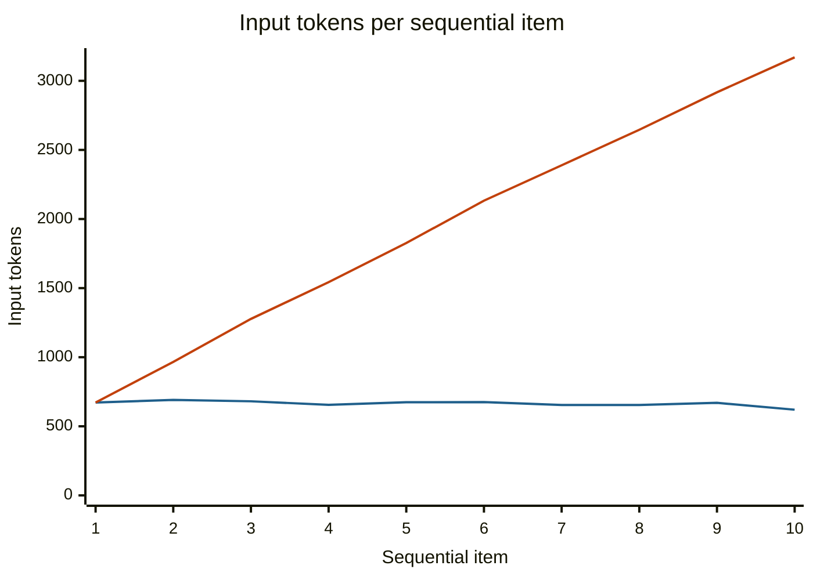

# Context-window evaluation

**Result (measured 2026-10-28, `claude-sonnet-5-5`):** with the context strategy on, each item cost about the
same, 620–691 input tokens, from the first item to the tenth. With it off, the cost grew with every item, from 672
to 3,170 input tokens (+372%), because each call carried all the earlier dialogue. Outcomes were the same apart from
one turn: 29 of 30 turns were classified correctly with the strategy on, and 30 of 30 with it off.

These are actual provider-reported input tokens from two live runs, one per setting, each in its own fresh thread.
The raw results are committed in [`docs/metrics/`](metrics/).

| Sequential item | Strategy ON input tokens | Strategy OFF input tokens | Live outcome check |
|---|---|---|---|
| 1 | 672 | 672 | ON correct, OFF correct |
| 2 | 691 | 966 | ON correct, OFF correct |
| 3 | 681 | 1,277 | ON correct, OFF correct |
| 4 | 655 | 1,543 | ON correct, OFF correct |
| 5 | 674 | 1,826 | ON correct, OFF correct |
| 6 | 675 | 2,133 | ON correct, OFF correct |
| 7 | 654 | 2,389 | ON correct, OFF correct |
| 8 | 654 | 2,646 | ON incorrect, OFF correct |
| 9 | 670 | 2,917 | ON correct, OFF correct |
| 10 | 620 | 3,170 | ON correct, OFF correct |

First to last item. ON: 672 → 620 input tokens (-52, -8%); OFF: 672 → 3,170 input tokens (+2,498, +372%).

Model claude-sonnet-5-5. ON thread return-c18e-7675-063d-4787-90f2-cc24-f7d0-5e7d (2026-10-28T22:56:59.247018+00:00); OFF thread return-78c5-173f-e306-48fa-a3b7-de6b-904e-4d34 (2026-10-28T22:57:57.373162+00:00).



Blue: strategy ON (flat). Orange: strategy OFF (rising).

ON varies a little between items because the exchanges differ in length, not because it grows: item 10 cost less
than item 1.

## What was measured

**The ten items.** Each item is a short Intake exchange of three taxpayer replies, run in order in one return
thread (`BENCHMARK_ITEMS` in [`src/memory.py`](../src/memory.py)). The first two replies are unclear, a correction,
or a request to go back ("Wait, I typed my birth year wrong", "Can we go back two questions?"). The third needs a
specific outcome:

| Item | Exchange | Third reply should be classified as |
|---|---|---|
| 1 | Unclear question, then asks for a person | `uncertain` (a volunteer) |
| 2 | Corrects a birth year, then asks when to take IRA money to pay less tax | `advice_request` |
| 3 | Goes back to the documents question, then mentions selling bitcoin | `out_of_scope` |
| 4 | Asks for the question another way, then says a son wants the refund in his account | `exploitation_concern` |
| 5 | Corrects an answer about pension forms, then mentions box 2b "taxable amount not determined" | `1099r_taxable_not_determined` |
| 6 | Goes back to change the blindness answer, then asks for a volunteer | `uncertain` |
| 7 | Doesn't follow the wording, then asks whether to file jointly or separately | `advice_request` |
| 8 | Corrects their income, then mentions renting out an apartment | `out_of_scope` |
| 9 | Goes back two questions, then says a caregiver demands the refund | `exploitation_concern` |
| 10 | "What?", then asks for someone from Kushim to call | `uncertain` |

**One model call per reply.** Each reply goes to Intake's classifier (`classify_with_model` in
`src/agents/intake.py`, the same function the Intake agent uses), so every item makes three calls. An item's
input tokens are the sum over its three calls, taken from the provider's `usage_metadata.input_tokens`. Nothing is
estimated: a call without reported usage fails the run.

**The two settings.**

- **Strategy ON** sends the classifier prompt, a short summary of confirmed answers (here, the filing status), and
  only the exchange in progress: the current reply plus the item's earlier replies. Earlier exchanges are left out.
- **Strategy OFF** sends the same prompt and summary plus every earlier classifier call in the thread.

In the real Intake flow, a reply is classified on its own, so ON there sends only the current reply. The benchmark
keeps the item's earlier turns so that a follow-up like "The one about my documents, I mean" is judged in context.

**Correct outcome.** An item counts as correct only if all three of its replies are. For the first two replies,
either asking the question again (`null`) or sending the taxpayer to a volunteer (`uncertain`) is correct. The third
reply must get its one expected classification. A malformed or unsupported response is never correct, even though
Intake would handle it safely by escalating.

## The one incorrect outcome

With the strategy on, item 8's last reply, "I also rent out the apartment over my garage", was classified as
`uncertain` instead of `out_of_scope`. With the strategy off, the same reply was classified correctly. The taxpayer
would still reach a volunteer, so the result is safe, but the category is wrong. Rental income is out of scope
(Schedule E, `data/policy.md`). In the real Intake flow the guardrail word list in `src/guardrails.py` runs before
the model, but it doesn't catch this sentence either: it matches "rent out my apartment" but not "rent out the
apartment". That gap is worth closing in the guardrail list.

We report this run as measured. We did not re-run to get a cleaner result.

## Reproduce

Needs `ANTHROPIC_API_KEY` in `.env`. Each run makes 30 model calls.

```bash
# Strategy ON, then OFF. Each writes output/context_{on,off}.json from a new thread.
SILVERFILE_DB_PATH=output/benchmark.sqlite python run.py --batch
SILVERFILE_DB_PATH=output/benchmark.sqlite python run.py --batch --no-context-strategy
# The ten rows, the growth line and the chart above; --out copies both raw files into docs/metrics/.
python -m src.metrics_table output/context_on.json output/context_off.json --out docs/metrics
```

- **Fresh threads.** Each run uses one new thread for all ten items, and ON and OFF use different threads. A thread
  id that was used before is refused, so pass a new `--thread-id` to repeat a run.
- **A separate database** (`SILVERFILE_DB_PATH`) keeps the benchmark threads out of the staff dashboard.
- **Failed outcomes.** A run with an incorrect outcome still saves its results, then exits nonzero. Each item's
  `turns` list shows the classification for every reply.
- **No hidden retries.** There are no automatic provider retries, and nothing is estimated. Cache and retry billing
  that the provider doesn't report are not counted.

`python -m src.memory --batch [--no-context-strategy]` runs the same benchmark directly.

## Limits

- **Intake's classifier only.** This measures the Intake classifier, the part of the system that holds a
  conversation. It does not measure W-2 extraction, and makes no claim about the cost of a whole return.
- **Ten items, not ten invoices.** The assignment (§4.5) asks for ten sequential invoices. This project prepares
  tax returns, so the team's working interpretation is ten sequential Intake exchanges in one return thread. That
  is a team assumption, not an instructor clarification.
- **One run per setting.** Model outputs vary between runs, so the single incorrect outcome could go either way on
  a re-run. The token curves come from the provider's own counts, and they depend on what is sent, not on chance.
- **Tests use synthetic numbers.** The provider doubles in the unit tests (`tests/test_memory.py`,
  `tests/test_batch_metrics.py`) report made-up token counts to test the plumbing. They are not results.

## Who did what

- **Iris:** the benchmark harness, selective recall and usage logging.
- **Max:** `run.py --batch` and the results-table generator.
- **Vidhatri:** the multi-turn items, the chart, and the live runs above.
