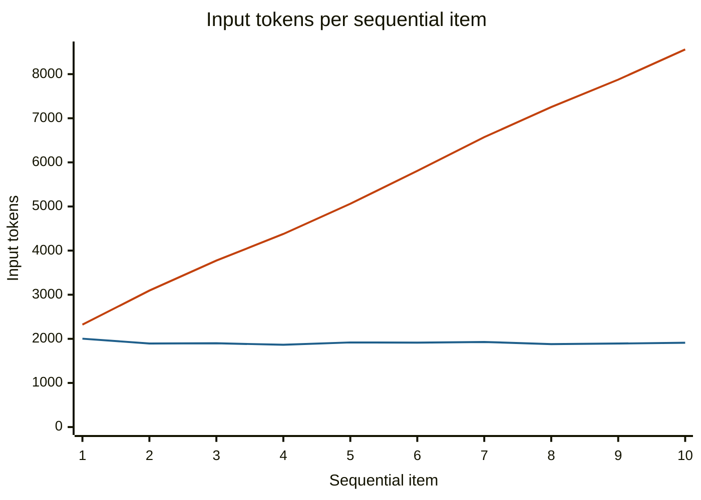

# Context-window evaluation

**Result (measured 2026-10-29, `claude-sonnet-5-5`):**

- **Tokens.** With the context strategy on, each item cost about the same, 1,865–2,003 input tokens, from the
  first item to the tenth. With it off, the cost grew with every item, from 2,321 to 8,560 input tokens (+269%),
  because each call carried all the earlier dialogue.
- **Accuracy.** Both settings classified 29 of 30 replies correctly (9 of 10 items fully right), and missed the same
  one. Leaving out the earlier dialogue cost no accuracy on these items.

These are actual provider-reported input tokens from two live runs, one per setting, each in its own fresh thread.
The raw results, with every turn's expected and actual classification, are committed in
[`docs/metrics/`](metrics/).

> **Read the accuracy as a development-set result.** The classifier prompt was rewritten after an earlier run on
> these same 30 replies (see [How we got here](#how-we-got-here)), so 29 of 30 is not an unbiased estimate of
> accuracy on new replies. A fresh, held-out set of replies would be needed for that. The token curves are not
> affected: they depend only on what is sent.

| Sequential item | Strategy ON input tokens | Strategy OFF input tokens | Live outcome check |
|---|---|---|---|
| 1 | 2,003 | 2,321 | ON incorrect, OFF incorrect |
| 2 | 1,895 | 3,094 | ON correct, OFF correct |
| 3 | 1,900 | 3,774 | ON correct, OFF correct |
| 4 | 1,865 | 4,377 | ON correct, OFF correct |
| 5 | 1,918 | 5,062 | ON correct, OFF correct |
| 6 | 1,914 | 5,806 | ON correct, OFF correct |
| 7 | 1,928 | 6,572 | ON correct, OFF correct |
| 8 | 1,881 | 7,254 | ON correct, OFF correct |
| 9 | 1,893 | 7,876 | ON correct, OFF correct |
| 10 | 1,912 | 8,560 | ON correct, OFF correct |

First to last item. ON: 2,003 → 1,912 input tokens (-91, -5%); OFF: 2,321 → 8,560 input tokens (+6,239, +269%).

Model claude-sonnet-5-5. ON thread return-f51d-f2c4-ab7c-40fc-9fdd-4ba7-0eba-f82a (2026-10-29T18:07:56.475962+00:00); OFF thread return-fb6c-0ad0-fcec-4a18-9900-142f-94ef-ecfd (2026-10-29T18:09:07.954819+00:00).



Blue: strategy ON (flat). Orange: strategy OFF (rising).

ON varies a little between items because the replies differ in length, not because it grows: item 10 cost less
than item 1. OFF already costs more in item 1, because the item's second and third replies carry the first.

## What was measured

**The ten items** are in [`evals/context_items.json`](../evals/context_items.json). Each is three unclear replies
to one Intake question, run in order in one return thread. Both runs use the same seed answers: items 1–9 seed
`filing_status = single`, and item 10 seeds `filing_status = mfs`, because its question (did you live with your
spouse in 2025?) is one Intake asks only of married-filing-separately filers (raised by Juee). Each item's seed
is recorded before its first turn as a new answer, so the earlier one stays in the history:

- **Muddled answers, corrections and requests to go back** ("Wait, scratch that, I meant the other one",
  "Let's back up a step") that don't use Intake's `go back to <field>` or `change <field> to <value>` commands.
- **Replies that need a specific outcome:** a volunteer, refusing to give advice, out-of-scope income, a 1099-R
  whose taxable amount is not determined, or a third party steering the return.

Each reply is sent as real Intake sends it, `{"question", "reply"}`, with Intake's own question text. A test checks
that no guardrail rule, command or field parser would handle any of them, so in a real session every one reaches
the model. Each reply has one expected label: 15 `null` (ask the question again), 8 `uncertain` (a volunteer), 2
each of `advice_request`, `exploitation_concern` and `out_of_scope`, and 1 `1099r_taxable_not_determined`.

**One model call per reply**, to Intake's classifier (`classify_with_model` in `src/agents/intake.py`, the same
function the Intake agent uses), so every item makes three calls. An item's input tokens are the sum over its three
calls, taken from the provider's `usage_metadata.input_tokens`. Nothing is estimated: a call without reported usage
fails the run.

**The two settings.**

- **Strategy ON** sends the classifier prompt, a short summary of confirmed answers (here, the filing status), and
  the current reply only. This is exactly what Intake sends in a real session.
- **Strategy OFF** sends the same prompt and summary plus every earlier classifier call in the thread.

**Correct outcome.** A reply is correct when the model's answer ends with a valid JSON object holding the expected
label. Anything else is never correct, even though Intake would handle it safely by escalating. An item is correct
only if all three of its replies are.

## The one miss

"Ugh, all those words blur together. The second one? Or third." was labelled `null` (ask the filing-status question
again). Both settings sent it to a volunteer (`uncertain`) instead. The taxpayer is unsure which status applies,
which `data/policy.md` section 11 treats as a reason to escalate, so this label is open to question. It is listed for
the team's review of the expected labels, not changed here.

## How we got here

The first live run on these items used the original classifier prompt, which named the six labels but didn't define
them. With the strategy on it got 20 of 30 replies right; with it off, 27 of 30:

- **Corrections and going back** ("the last thing I told you was wrong, can we redo it?") were the main problem.
  With the strategy on, the model sent 7 of them to a volunteer instead of asking again.
- **A nephew controlling the money** ("he says to just put whatever he tells me") came back `uncertain` instead of
  `exploitation_concern` in both settings.

Two changes followed, both in the classifier itself rather than in the benchmark:

1. **The prompt now defines each label** from `data/policy.md` sections 8–11 (`CLASSIFIER_PROMPT` in
   `src/memory.py`). Corrections and requests to go back are named as reasons to ask again, and a third party
   controlling the money is named as exploitation.
2. **The answer is read from its last line.** With the longer prompt, the model sometimes wrote a sentence of
   reasoning before the JSON. Intake now reads a JSON object on the last line and still keeps nothing else.

The longer prompt makes every call bigger: about 1,900 input tokens per item with the strategy on, up from about
730. That is the price of the accuracy gain, and it doesn't grow with the session.

**Keeping earlier replies under ON.** We considered sending the earlier replies to the current question as well,
to help with corrections. With the defined prompt, ON already gets 29 of 30 using only the current reply, the same
as OFF, so this wasn't added: ON stays exactly what Intake does in a real session.

Earlier runs on different items are not comparable and are not in the table: one sentence per item (ON 207 flat,
OFF 207 → 594), and #22's three-turn items sent as plain text (ON 620–691, OFF 672 → 3,170).

We report every run as measured. None was repeated to get a cleaner result.

## Reproduce

Needs `ANTHROPIC_API_KEY` in `.env`. Each run makes 30 model calls.

```bash
# Strategy ON, then OFF. Each writes output/context_{on,off}.json from a new thread.
SILVERFILE_DB_PATH=output/benchmark.sqlite python run.py --batch
SILVERFILE_DB_PATH=output/benchmark.sqlite python run.py --batch --no-context-strategy
# The ten rows, the growth line and the chart above; --out copies both raw files into docs/metrics/.
python -m src.metrics_table output/context_on.json output/context_off.json --out docs/metrics
```

- **Fresh threads.** Each run uses one new thread for all ten items, and ON and OFF use different threads. A thread
  id that was used before is refused, so pass a new `--thread-id` to repeat a run.
- **A separate database** (`SILVERFILE_DB_PATH`) keeps the benchmark threads out of the staff dashboard.
- **Failed outcomes.** A run with an incorrect outcome still saves its results, then exits nonzero. Each item's
  `turns` list shows the reply, the expected label, the model's label, validity and tokens for every turn.
- **No hidden retries.** There are no automatic provider retries, and nothing is estimated. Cache and retry billing
  that the provider doesn't report are not counted.

`python -m src.memory --batch [--no-context-strategy]` runs the same benchmark directly.

## Limits

- **Intake's classifier only.** This measures the Intake classifier, the part of the system that holds a
  conversation. It does not measure W-2 extraction, and makes no claim about the cost of a whole return. The return
  graph uses the classifier only when Intake is built with a model (`make_intake`); otherwise Intake is
  deterministic.
- **Ten items, not ten invoices.** The assignment (§4.5) asks for ten sequential invoices. This project prepares
  tax returns, so the team's working interpretation is ten sequential Intake exchanges in one return thread. That
  is a team assumption, not an instructor clarification.
- **A development set.** The prompt was tuned using misses on these replies, so the accuracy above is optimistic for
  new replies.
- **One run per setting.** Model outputs vary between runs, so individual classifications could change on a re-run.
- **Expected labels.** The 30 labels were set by the team against `data/policy.md` and still need the guardrails
  owner's sign-off; at least one (above) is debatable.
- **Tests use synthetic numbers.** The provider doubles in the unit tests (`tests/test_memory.py`,
  `tests/test_batch_metrics.py`, `tests/test_context_items.py`) report made-up token counts to test the plumbing.
  They are not results.

## Who did what

- **Iris:** the benchmark harness, selective recall and usage logging.
- **Max:** `run.py --batch`, the results-table generator, and the ten multi-turn items in production input shape.
- **Vidhatri:** the chart, the classifier prompt definitions and last-line parsing, and the live runs above.
